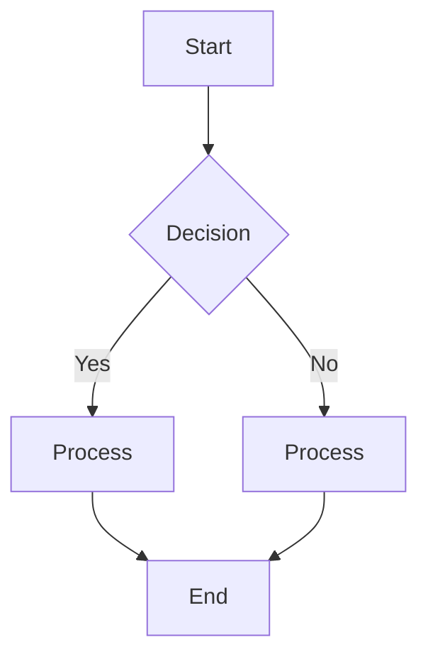

# Welcome to Agentic Workflows!
_It seems like every day we hear about new breakthroughs in Artificial Intelligence. It’s a fast-moving field, and it can be challenging to sort through the noise to find what’s truly useful. This course is designed to do just that. We are going to build a solid foundation of knowledge by focusing on the core concepts of **agentic workflows**, using Python and direct API calls to an LLM to understand how these systems work from the ground up._

_So, what exactly is an **AI agent**?_

_Think of a modern AI agent as a system that uses a Large Language Model (LLM) as its "brain." This allows the agent to understand complex goals, reason about problems, and make decisions. But it doesn't stop there. A true agent is designed to act. It can perceive its environment, make plans, and use tools to accomplish its goals with a high degree of autonomy._

_And what happens when these agents work together? That’s an **agentic workflow**._

_An agentic workflow is a system where multiple agents collaborate or work in sequence to achieve a complex goal. Unlike traditional automation, which follows a rigid, step-by-step script, an agentic workflow is dynamic. The agents can adapt their approach based on new information, making them powerful tools for solving complex problems._

_For example, consider this workflow diagram:_

_At first glance, this might look like a standard, automated process. But is it an agentic workflow? To answer that, we need to look closer. Do the components in this diagram simply follow a fixed path, or do they make decisions and adapt their actions based on the situation?_